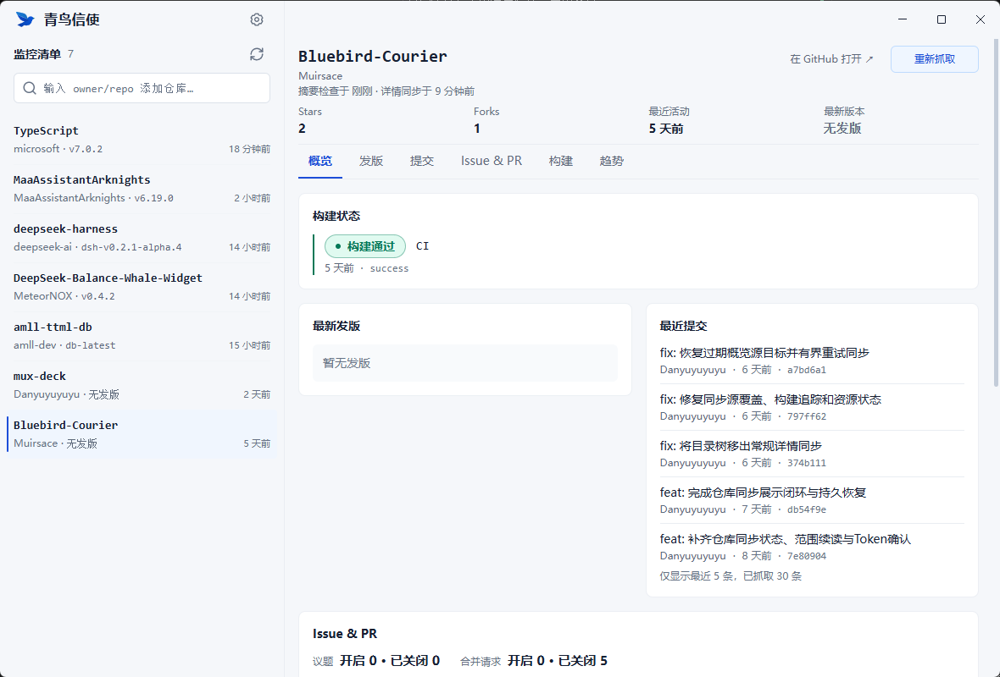

<p align="center">
  
</p>

<h1 align="center">青鸟信使 Bluebird Courier</h1>

<p align="center">本地优先的 GitHub 仓库监控桌面应用</p>

把关注的仓库放进监控清单，一眼看出哪些仓库出了新版本、有新提交或构建出了问题；Stars / Forks 趋势随使用在本机自然积累。数据全部留在本机，关闭即停，不留后台进程。目前支持 Windows（Electron）。

<!-- TODO: 替换为实际截图，例如 docs/images/watchlist.png -->


## ✨ 功能

- **监控清单**：粘贴 `owner/repo` 或 GitHub 网址即可加入，卡片显示 Stars、最近活动、最新版本
- **仓库详情**：发版、提交、Issue & PR、构建状态、趋势，打开先看本地缓存
- **历史趋势**：每天自动留一档快照，Stars 与 Forks 分图展示（7D / 30D）
- **本地与安全**：令牌经系统钥匙串加密，数据不上传任何服务器，断网可查看已有内容

## 📦 安装

> ⚠️ 暂无正式安装包，需要自行构建（需 Node.js 22.12+ 或 24.x）。

```bash
npm install
npm run dist   # 安装器输出到 release/
```

首次启动时，在设置页粘贴一个 [GitHub 个人访问令牌](https://github.com/settings/tokens)（只读公开仓库即可），点「保存并验证」。

## 🏁 开发快速开始

```bash
npm install
npm start          # 构建并启动 Electron
npm test           # 运行测试
npm run typecheck  # 类型检查
```

## 📚 文档

| 文档 | 内容 |
|---|---|
| [使用指南](docs/user-guide.md) | 令牌、主题、清单与详情、趋势、出错处理、数据与隐私 |
| [开发指南](docs/development.md) | 技术栈、环境要求、Windows 故障排查、打包、路线图 |
| [架构说明](docs/architecture.md) | 分层架构、IPC 边界、外链安全、领域词汇 |
| [抓取与 GitHub API](docs/github-api.md) | 请求端点、限流、超时与并发规则 |
| [测试](docs/testing.md) | 测试策略与覆盖范围 |

## 📜 许可

私有项目（UNLICENSED）。
